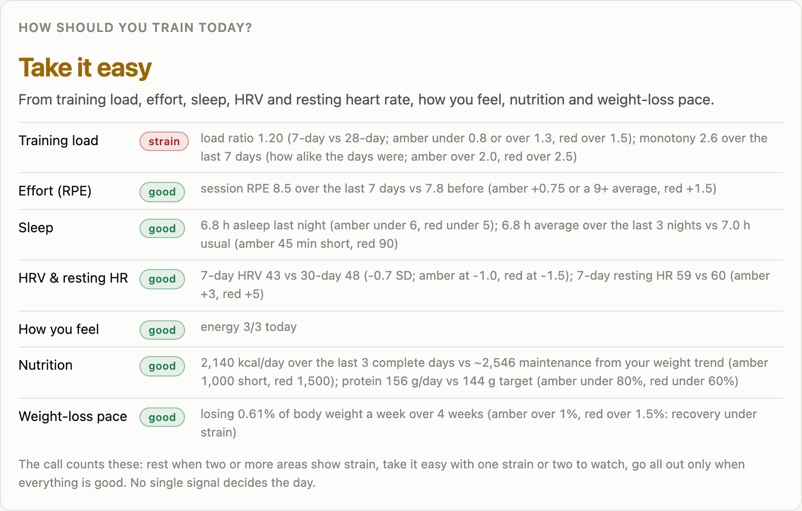
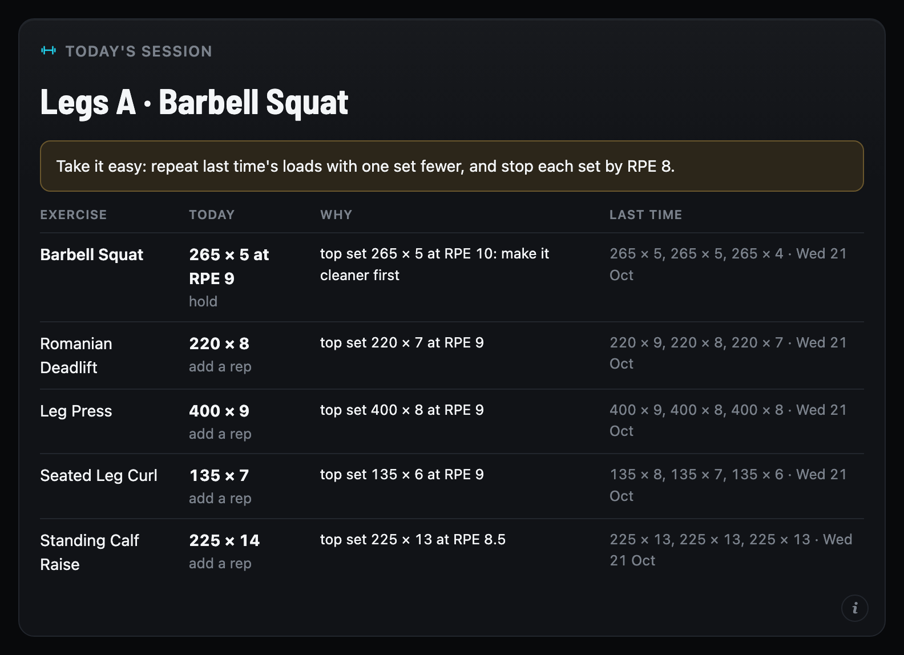
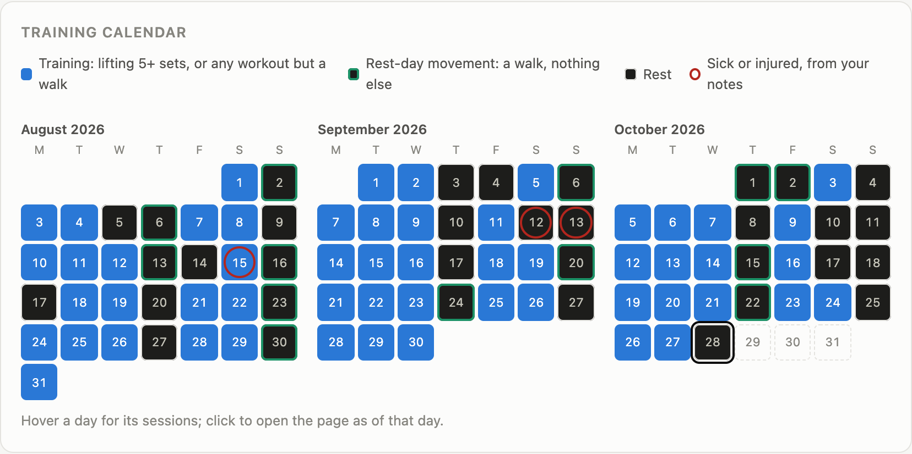
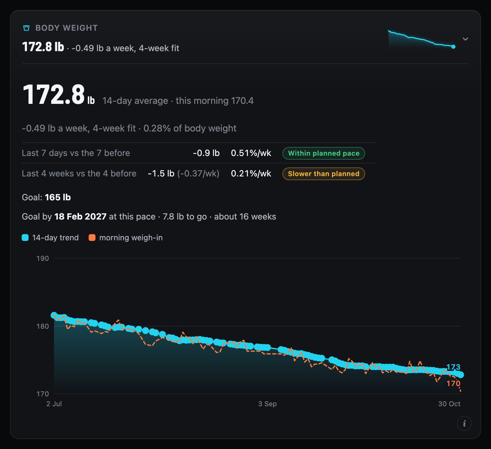
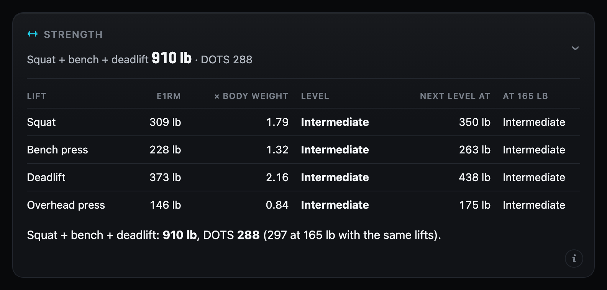
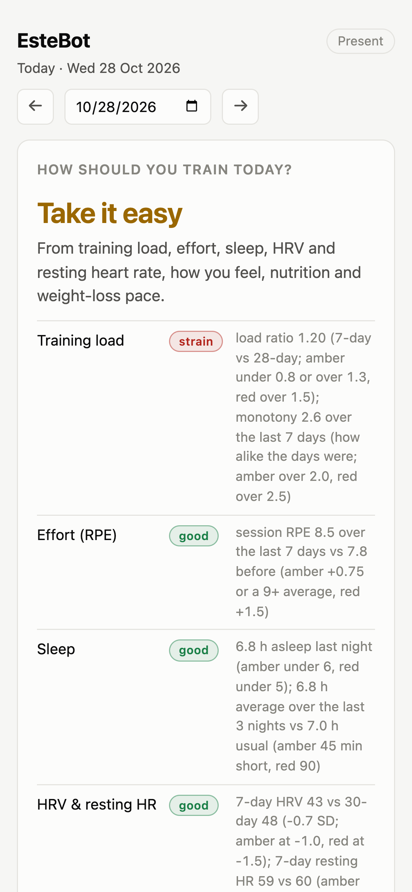

# EsteBot

**Your training, sleep, food and weight, turned into one straight answer every morning.**

EsteBot pulls in everything I already track (Apple Health, Hevy workouts, Cronometer food
logs and a live feed from my phone), cleans it up, and runs it through custom algorithms
built for one athlete. Every morning it tells me how hard to train, what to lift, whether
the weight is really moving and what I'm short on. And I can ask it anything in plain
English.

**▶ Live demo: [estebot.app](https://estebot.app)** — a made-up athlete, regenerated every
day. Read-only; the first load after a quiet spell takes a few seconds while the server
wakes up.

## What it does

- **One call a day.** Seven signals (training load, effort, sleep, HRV and resting heart
  rate, how you feel, food, weight-loss pace) each get a vote. Out comes a 0–100 readiness
  score and a verdict from *rest* to *go all out*. One bad night never decides your day.
- **Your next session, already planned.** It knows where you are in the rotation and sets a
  target for every exercise from the last time you did it, dialled back on a take-it-easy day.
- **A weight trend that sees through the noise.** A 14-day average and a fitted weekly rate
  that ignore water swings, checked against your planned pace, with a projected goal date.
- **Strength that's fair to your size.** Estimated one-rep maxes, scaled to body weight,
  with DOTS for the big three.
- **Nutrition down to the micronutrients.** Calories against what the scale says you burn,
  protein against target, and vitamins and minerals against reference intakes, food
  and supplements together.
- **Ask EsteBot.** Claude answers questions about your data from EsteBot's own numbers. The
  algorithms decide; the AI explains.





<details>
<summary>More: the training calendar, weight trend, strength standards, and the page on a phone</summary>






</details>

## From four messy apps to one clean day

Health data is messy. Every app has its own format, its own quirks and its own blind
spots. EsteBot's pipeline streams a multi-gigabyte Apple Health export at constant memory,
pulls Hevy and Cronometer every day, takes a live feed from the phone, and lines it all up
into one tidy record per day that the algorithms can trust. Fixes are dated rules applied
at import, never hand edits, so years of history rebuild exactly, every time.

A few of the traps it handles:

- Apple emits overlapping sleep records per device and per stage, so summing them
  double-counts. Intervals are unioned first.
- A night spans midnight, so filing sleep by calendar date splits it in two. Segments are
  shifted back 12 hours, which also sends an afternoon nap forward to the coming night.
- Watch and iPhone both count steps over the same intervals. The full export keeps the
  largest single-device total for the day rather than the sum.
- The lifting app changed its dumbbell entry from per-hand to combined weight partway
  through the history. Dated correction rules fix it at import; the source data is never
  edited.
- An exercise substitution is not a strength change. A trap bar carry is not a dumbbell
  carry. Renames are dated and keep the series apart, so a swap can't manufacture a gain.
- Pull-ups are logged at 0 lb. Their load is body weight, taken from the 14-day weight
  trend, so on a cut the same reps correctly show up as less strength.
- Epley's 1RM estimate drifts badly above about 10 reps, so those sets return `None`. Not
  `0.0`: a zero is a number and quietly drags down any median taken over the column.

## Built to be trusted

1. **Custom algorithms, not AI guesses.** Every figure you might act on comes from
   EsteBot's own algorithms. A language model explains the results; it never invents one.
   Otherwise there'd be no telling a real signal from a confident guess.
2. **One source of truth.** Every metric has exactly one implementation, shared by the
   page, the text report and the chat, so they can never disagree.
3. **Private data stays private.** Personal data lives in a separate private repo. This
   repo holds only code, and CI plus git hooks stop anything personal from ever landing
   here.

Predictions are written down before the data arrives, with a resolution date and a
minimum amount of data, and they're allowed to come back inconclusive. Early analyses of
this dataset produced two confident headlines that turned out to be wrong; a written
record is what stops anyone, me or a model, from deciding afterwards they were right.

## Try it on demo data

You don't need my data or any exports. The demo module writes a synthetic data directory
for a made-up person:

```bash
git clone https://github.com/sasper/estebot && cd estebot
python -m venv .venv && ./.venv/bin/pip install -e ".[dev,web]"

./.venv/bin/python -m estebot.demo --out /tmp/estebot-demo
```

That writes six months of a made-up person's weigh-ins, lifting, sleep, food and notes, plus
an `estebot.toml` pointing at them. Load it into the app's database and start the page:

```bash
export ESTEBOT_CONFIG=/tmp/estebot-demo/estebot.toml
./.venv/bin/python -m estebot.web.ingest
./.venv/bin/uvicorn estebot.web.main:app --port 8000
```

The same seed always gives the same data. `--seed` picks another person, and `--end today`
moves the six months up to today.

## Running it on your own exports

```bash
cp estebot.example.toml estebot.toml      # then edit data_dir, the export globs, your profile

./.venv/bin/python -m estebot.parsers.apple_health   # streams the multi-GB export, ~8 min
./.venv/bin/python -m estebot.parsers.jefit          # lifting tables (merges Hevy too)
./.venv/bin/python -m estebot.parsers.cronometer
./.venv/bin/python -m estebot.web.ingest             # tidy CSVs -> the app's SQLite cache
./.venv/bin/python -m estebot.analysis.report        # a text summary
```

Getting the exports: Apple Health, profile icon, Export All Health Data. Jefit, Account,
export training logs. Cronometer, Profile, gear, Export Data, Daily Nutrition. Each
source's filename pattern is a glob in the config, so a new export is picked up without
edits. Hevy and Cronometer can also be pulled automatically (see `daily.py`); both read
their credentials from the macOS Keychain, never from a file.

## How it fits together

The short version is below. [ARCHITECTURE.md](ARCHITECTURE.md) has the data flow, the rules in
more depth, how I verify refactors, and the known problems.

```
 exports / APIs                 parsers/                 private data repo         app
 --------------                 --------                 -----------------         ---
 Apple Health export.xml  --->  apple_health.py  ---+
 Health Auto Export JSON  --->  health_auto_export  |
 Jefit CSV, Hevy API      --->  jefit.py, hevy.py   +-->  tidy/*.csv  --> ingest --> app.sqlite
 Cronometer CSV           --->  cronometer.py    ---+     (derived,                 |
                                                           rebuildable)              v
 notes from the phone     --->  notes.py  ---------------> health-context.txt   analysis/engine.py
                                                                                     |
 authored: ledger.md, annotations.csv, corrections.csv, renames.csv                  v
                                                                                web/ (FastAPI,
                                                                                inline SVG charts)
```

| Module | What it does |
|---|---|
| `config.py` | Reads the TOML config: where the data lives and every source's glob. Uses `tomllib`, so no dependency. |
| `core.py` | Pure functions, no I/O. Most of them exist because the naive version gave a wrong answer once. |
| `parsers/` | One per source. Stdlib only. The Apple Health parser streams a ~2 GB XML file at constant memory. |
| `analysis/engine.py` | Coverage gates, load ratio, the readiness signals, strength standards, the next-session plan. |
| `analysis/nutrition.py` | Energy balance, protein, and micronutrient gaps against the US reference intakes. |
| `analysis/predictions.py` | Reads the prediction ledger and shows interim progress on open claims. |
| `web/` | FastAPI and Jinja templates. It formats numbers the engine computed; it does not compute its own. |
| `daily.py` | The unattended daily sync, scheduled with launchd on macOS. |

Derived data is disposable and gets rebuilt from the exports. Authored data (annotations,
the ledger, dated correction rules) lives apart from it, because only a person can
produce it.

## Tests

```bash
pytest -q
```

Tests in `tests/test_core.py` each correspond to a bug that actually happened. CI runs the
suite on Python 3.11, 3.12 and 3.13, and a separate job fails if any personal-data path is
tracked.

## Status

[HISTORY.md](HISTORY.md) is how it got here: the first three weeks, stage by stage, and what each
one taught me.

I use it every day, for one person. The personal values (height, goals, file locations)
are in config, but some assumptions are still mine: imperial units on the page, a
push/pull/legs rotation as the default training split (`[training]` in config changes it), and
reference intakes for one demographic.
The daily sync and the page service assume macOS and launchd.

## License

MIT
